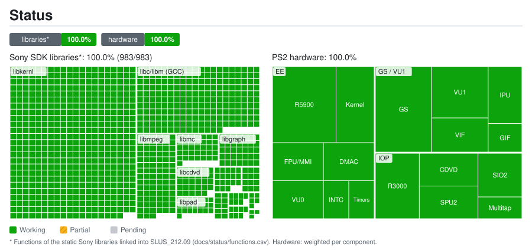

# Port status: details

Generated by `tools/status/generate.py` from `docs/status/data.toml` and `docs/status/functions.csv`. Do not edit by hand.

## Sony SDK libraries*: 100.0% (983/983)

| Library | Functions | Status | Note |
|---|---:|---|---|
| `libdma` | 12 | ✅ Working |  |
| `libgraph` | 35 | ✅ Working | Includes the VRAM→EE download through the VIF1 FIFO |
| `libpkt` | 10 | ✅ Working |  |
| `libpad` | 22 | ✅ Working | The game's own PADMAN over the emulated SIO2 (start approx.) |
| `libmtap` | 7 | ✅ Working | Original MTAPMAN over the multitap emulated on the SIO2 (start approx.) |
| `libsdr` | 7 | ✅ Working | Emulated SPU2 with reverb; ADMA (CRI ADX music/voices) (start approx.) |
| `libcdvd` | 29 | ✅ Working | Reads the original ISO |
| `libscf` | 18 | ✅ Working |  |
| `libipu` | 5 | ✅ Working | Original code over the emulated IPU: Sofdec videos play |
| `libmpeg` | 87 | ✅ Working | The game's own libmpeg (used by CRI Sofdec's M2V decoder) drives the emulated IPU |
| `libmc` | 36 | ✅ Working | Original MCMAN/MCSERV; PCSX2-compatible Mcd001.ps2 (start approx.) |
| `libpc` | 3 | ✅ Working |  |
| `libkernl` | 498 | ✅ Working | HLE syscalls; SIF RPC and the real IRX modules on the emulated IOP |
| `libc/libm (GCC)` | 214 | ✅ Working |  |

## PS2 hardware: 100.0%

| Group | Component | Weight | Status | Note |
|---|---|---:|---|---|
| EE | R5900 CPU (recompiled to C++, Ghidra function map) | 5 | ✅ Working |  |
| EE | Kernel: threads, semaphores, alarms | 3 | ✅ Working |  |
| EE | FPU (COP1) and MMI instructions (permutations fixed) | 2 | ✅ Working |  |
| EE | VU0: macro (COP2) and micro (VCALLMS, compiled AOT) mode | 2 | ✅ Working |  |
| EE | INTC with latch and W1C | 1 | ✅ Working |  |
| EE | DMA controller (including scratchpad chain and interleave modes) | 2 | ✅ Working |  |
| EE | Timers (T3 driven by H-BLANK) | 1 | ✅ Working |  |
| GS / VU1 | GS: PCSX2's hardware renderer (DX11) on its own thread; the port's own OpenGL GS stays as an option | 5 | ✅ Working | 1x-8x internal resolution, PCSX2's filters, HD textures; frames locked to 60/120/240 Hz monitors |
| GS / VU1 | VU1: microprograms (skinning, scene), compiled AOT | 3 | ✅ Working | On its own thread (MTVU); 8-fighter brawl at 60 FPS |
| GS / VU1 | VIF0/VIF1 (UNPACK, MPG, DIRECT) | 2 | ✅ Working |  |
| GS / VU1 | GIF: PATH1/2/3 | 1 | ✅ Working |  |
| GS / VU1 | IPU (MPEG decoder), emulation taken from the Ace Combat 5 recompilation | 2 | ✅ Working |  |
| IOP | Interpreted R3000A IOP running the original IRX modules | 3 | ✅ Working |  |
| IOP | CD/DVD from the ISO | 2 | ✅ Working |  |
| IOP | SPU2: voices, ADMA, reverb | 2 | ✅ Working | Rate control and time-stretch; open: in some runs the opening video's right channel plays 171 ms early |
| IOP | SIO2: controller (DualShock 2) and memory card | 2 | ✅ Working | PC controllers through SDL3 with vibration, PCSX2-style controls.ini |
| IOP | Multitap (4-8 players) | 1 | ✅ Working | Port 2 by default (controls.ini [Pad] MultitapPort2) |

* Functions of the static Sony libraries linked into SLUS_212.09 (docs/status/functions.csv). Hardware: weighted per component.
