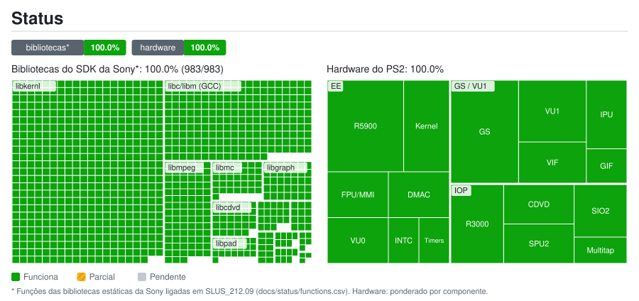

# Status do port: detalhes

Gerado por `tools/status/generate.py` a partir de `docs/status/data.toml` e `docs/status/functions.csv`. Não edite à mão.

## Bibliotecas do SDK da Sony*: 100.0% (983/983)

| Biblioteca | Funções | Status | Nota |
|---|---:|---|---|
| `libdma` | 12 | ✅ Funciona |  |
| `libgraph` | 35 | ✅ Funciona | Inclui o download VRAM→EE pela FIFO do VIF1 |
| `libpkt` | 10 | ✅ Funciona |  |
| `libpad` | 22 | ✅ Funciona | PADMAN original do jogo sobre o SIO2 emulado (início aprox.) |
| `libmtap` | 7 | ✅ Funciona | MTAPMAN original sobre o multitap emulado no SIO2 (início aprox.) |
| `libsdr` | 7 | ✅ Funciona | SPU2 emulado com reverb; ADMA (música/vozes CRI ADX) (início aprox.) |
| `libcdvd` | 29 | ✅ Funciona | Lê a ISO original |
| `libscf` | 18 | ✅ Funciona |  |
| `libipu` | 5 | ✅ Funciona | Código original sobre o IPU emulado: os vídeos Sofdec tocam |
| `libmpeg` | 87 | ✅ Funciona | A libmpeg original do jogo (usada pelo M2V do CRI Sofdec) controla o IPU emulado |
| `libmc` | 36 | ✅ Funciona | MCMAN/MCSERV originais; Mcd001.ps2 compatível com o PCSX2 (início aprox.) |
| `libpc` | 3 | ✅ Funciona |  |
| `libkernl` | 498 | ✅ Funciona | Syscalls HLE; SIF RPC e os módulos IRX reais no IOP emulado |
| `libc/libm (GCC)` | 214 | ✅ Funciona |  |

## Hardware do PS2: 100.0%

| Grupo | Componente | Peso | Status | Nota |
|---|---|---:|---|---|
| EE | CPU R5900 (recompilada para C++, mapa de funções com Ghidra) | 5 | ✅ Funciona |  |
| EE | Kernel: threads, semáforos, alarmes | 3 | ✅ Funciona |  |
| EE | FPU (COP1) e instruções MMI (permutações corrigidas) | 2 | ✅ Funciona |  |
| EE | VU0: modo macro (COP2) e micro (VCALLMS, compilado AOT) | 2 | ✅ Funciona |  |
| EE | INTC com latch e W1C | 1 | ✅ Funciona |  |
| EE | Controlador DMA (inclui scratchpad em chain e interleave) | 2 | ✅ Funciona |  |
| EE | Temporizadores (T3 por H-BLANK) | 1 | ✅ Funciona |  |
| GS / VU1 | GS: renderizador de hardware do PCSX2 (DX11) numa thread própria; o GS próprio em OpenGL fica como opção | 5 | ✅ Funciona | Resolução interna 1x-8x, filtros do PCSX2, texturas HD; quadros sincronizados com monitores de 60/120/240 Hz |
| GS / VU1 | VU1: microprogramas (skinning, cena), compilados AOT | 3 | ✅ Funciona | Numa thread própria (MTVU); luta de 8 a 60 FPS |
| GS / VU1 | VIF0/VIF1 (UNPACK, MPG, DIRECT) | 2 | ✅ Funciona |  |
| GS / VU1 | GIF: PATH1/2/3 | 1 | ✅ Funciona |  |
| GS / VU1 | IPU (decodificador MPEG), emulação vinda da recompilação do Ace Combat 5 | 2 | ✅ Funciona |  |
| IOP | IOP R3000A interpretado com os IRX originais | 3 | ✅ Funciona |  |
| IOP | CD/DVD a partir da ISO | 2 | ✅ Funciona |  |
| IOP | SPU2: vozes, ADMA, reverb | 2 | ✅ Funciona | Controle de taxa e time-stretch; em aberto: em parte das execuções o canal direito do vídeo de abertura sai 171 ms adiantado |
| IOP | SIO2: controle (DualShock 2) e memory card | 2 | ✅ Funciona | Controles do PC pelo SDL3 com vibração, controls.ini no formato do PCSX2 |
| IOP | Multitap (4-8 jogadores) | 1 | ✅ Funciona | Porta 2 por padrão (controls.ini [Pad] MultitapPort2) |

* Funções das bibliotecas estáticas da Sony ligadas em SLUS_212.09 (docs/status/functions.csv). Hardware: ponderado por componente.
